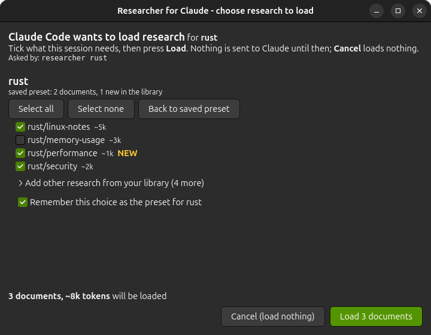
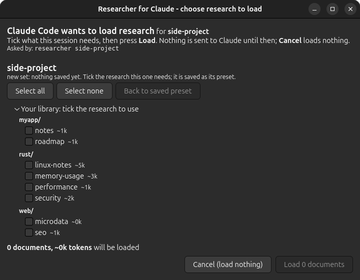

# Researcher for Claude

Load your saved research into a [Claude Code](https://claude.com/claude-code) session in one step, and only the part you need.

If you keep research notes, reports, or saved articles on disk and keep telling Claude "read my notes on X first", this does that for you. You name a **set** (`/researcher rust`), a small window lists the documents with their size in tokens, you tick what this session needs, and Claude reads exactly those. No tokens are spent while the window is open or on anything you leave unticked.

- **Sets** are named lists of documents in a small `config.toml`. Sets can include other sets, and ids can be globs (`rust/*`).
- **Saved defaults** per set: next time your last choice is pre-ticked, and documents added since are marked **NEW**.
- **Custom sets**: name a set you never defined (`/researcher side-project`) and the first call shows your whole library; what you tick becomes that set.
- **Formats**: `.html`, `.md`, `.txt`, and `.pdf` (through `pdftotext`). Folders with an `index.html` count as one document.
- **Read-only**: your library is never changed. Converted text goes to a cache folder.

## How it looks

The first picture is a set with a saved preset: the documents you ticked last time are ticked, a document added since is marked **NEW**, and the rest of your library is folded under "Add other research". The second is a set you have never used: your whole library, grouped by folder, with nothing ticked. **Cancel (load nothing)** always leaves without sending anything.





Both pictures use the made-up documents in [examples/library](examples/library). `tools/screenshots.py` makes them again (it opens the popup twice for two seconds, needs a display, and touches none of your own files).

## Requirements

- Python 3.11 or newer (3.11 for `tomllib`)
- For the popup: GTK 4 and PyGObject (`python3-gi`, `gir1.2-gtk-4.0` on Debian/Ubuntu, `python3-gobject gtk4` on Fedora/Arch). Without a display it uses your saved defaults.
- For PDFs: `pdftotext` from poppler (`poppler-utils`)
- Linux. The popup is GTK 4 only for now; a Tk popup for macOS and Windows would be a welcome contribution.

## Install

```bash
git clone https://github.com/LudaLunizz/researcher-for-claude.git
cd researcher-for-claude
mkdir -p ~/.claude/skills
cp -r skills/researcher ~/.claude/skills/        # or: ln -s "$PWD/skills/researcher" ~/.claude/skills/researcher

python3 ~/.claude/skills/researcher/researcher.py --init ~/research   # writes ~/.config/researcher/config.toml
```

Try it first on the made-up documents in [examples/library](examples/library): `researcher.py --library examples/library rust`. Then edit `~/.config/researcher/config.toml` (see [examples/config.toml](examples/config.toml)) and in Claude Code type `/researcher rust`, or just say "load my research for rust".

## Configure

```toml
library = "~/research"        # folder with your documents
default_set = "rust"          # used when you name no set
exclude = ["scratch/*"]       # ids left out of the library (globs)

[aliases]
rs = "rust"

[sets.rust]                   # a topic
docs = ["rust/linux-notes", "rust/memory-*"]

[sets.myapp]                  # a project: other sets plus its own documents
include = ["rust"]
docs = ["myapp/roadmap"]
```

A document id is its path inside the library without the extension: `~/research/rust/linux-notes.html` is `rust/linux-notes`. If `x.html` and `x.pdf` both exist, the HTML one is used. Hidden files and folders are skipped. `all` is a built-in set with the whole library.

`RESEARCHER_LIBRARY` or `--library PATH` overrides the library for one run.

## Command line

```
researcher.py [SET ...]              popup, then convert the ticked documents and print their paths
researcher.py --setup SET            popup only: change the saved defaults, load nothing
researcher.py --no-popup SET         use the saved defaults without asking
researcher.py --list                 sets, document counts, saved defaults
researcher.py --init [LIBRARY]       write a starter config
```

The script prints one path per ticked document; the skill tells Claude to read each one in full. Exit codes: 0 ok, 2 unknown set, 3 cancelled, 4 popup timed out, 5 custom set with no saved choice and no popup, 6 config or library problem.

Files: config and saved choices in `~/.config/researcher/` (`config.toml`, `choices.json`), converted text in `~/.cache/researcher/`.

## Safety

Documents are loaded into Claude's context as text. Treat them like any untrusted input: a saved web page can contain instructions aimed at an AI. The skill tells Claude to treat document contents as reference material, not as commands, but only load documents you trust.

## Tests

```bash
python3 -I -m unittest discover -s tests -v
```

The tests cover the library scan, set expansion, saved defaults, custom sets, and the command line. The popup needs a display and is not covered by CI. It only opens when the script is run for a load or `--setup`; set `RESEARCHER_NO_POPUP=1` to make that impossible (scripts, CI).

## License

GNU Affero General Public License v3.0 or later (AGPL-3.0-or-later), see [LICENSE](LICENSE). Your own documents and config are never part of this repository and are not covered by it.
